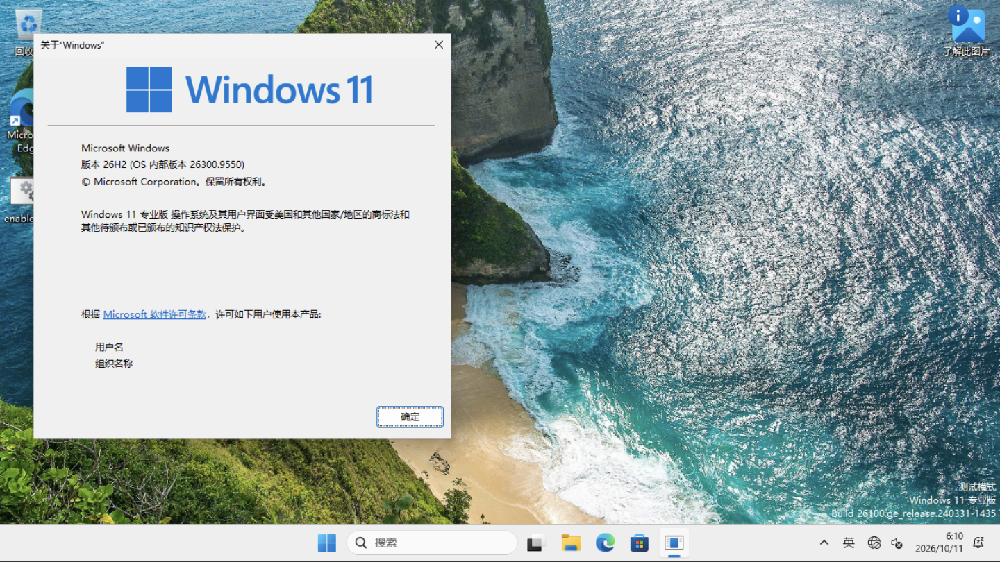

# K70 Pro：Windows 11 Pro 26H2 验证记录

2026-10-11，构建产物 **Windows 11 专业版 26H2、Build 26300.9550（KB5124010）** 已在 Redmi K70 Pro 上进入中文桌面。原 Windows11 条目已切换到新专业版磁盘，手机原生显示中打开的 `winver` 确认了专业版、26H2 和 `26300.9550`。以下结论只覆盖本次列出的环境，不代表所有 Snapdragon 8 Gen 3 手机或长期稳定性。

## 构建与文件校验

- [成功构建 38108924414](https://github.com/collegeming/win11-arm64-image-builder/actions/runs/38108924414)，构建提交 `17d7108`。
- [专业版 Release](https://github.com/collegeming/win11-arm64-image-builder/releases/tag/win11-pro-26H2-26300.9550-arm64-38108924414)。
- 官方 zh-CN ARM64 ISO 的索引 3 为专业版。脚本按 `EditionID=Professional`、ARM64 架构选择，拒绝家庭版和错误架构。
- KB5124010 ARM64 下载包 SHA256 与 Microsoft Update Catalog 记录一致。离线服务完成后，包 `Package_for_RollupFix~31bf3856ad364e35~arm64~~26100.9550.1.28` 为 `Installed`，`update_pending_first_boot=false`。
- 实际离线注册表为 `EditionID=Professional`、`DisplayVersion=26H2`、`CurrentBuildNumber=26300`、`UBR=9550`；本地解出的磁盘也经只读挂载再次核对。
- 安装包完整 SHA256：`96261a6dd0c75e9ede4a1bc2802726552c18a716910b473df2613dacdc349013`。
- 未启动原始 QCOW2 SHA256：`a5a3770849dfe50960ae43864bdb1fe56cf7ca97fd9fd1a9fcb8073ca4584300`。本地文件和手机上传后文件均匹配。启动后的可写磁盘会变化，不能继续用原始散列判定启动后文件完整性。
- `qemu-img check` 对本地原始磁盘和手机上传后的磁盘均未发现结构错误。

`image-metadata.json` 中 `ProductName` 的旧兼容字符串不是版本选择依据；本次以 EditionID、DisplayVersion、CurrentBuildNumber/UBR 与在线 `winver` 一致性验收，没有改写注册表来伪造版本名称。

## 实机配置

| 项目 | 验证环境 |
|---|---|
| 手机 / SoC | Redmi K70 Pro / SM8650 |
| 宿主内核 | GKI 6.1.138，含 VMID 与 kvcalloc 修复 |
| DroidVM | `0.0.6.r240.5c89691-dev` |
| 模式 | `protected_without_firmware` |
| CPU / 内存 | 2 CPU / 1792 MiB |
| restricted-DMA 缓冲池 | `swiotlb` 256 MiB |
| 大页 | `hugepages=true` |
| LEND 预整理 | `prepare_lend_mthp=disabled` |
| 显示 | SimpleFB，原生显示，1280×720，30 Hz |
| GPU / USB | 禁用 |
| 网络 | 无 NIC |

仓库 `vms.json` 使用上述保守配置。模板是可复现的设置，不等于每台手机都通过验证。宿主修复和多项配置共同使用，没有独立对照证明某项参数单独导致启动成功。

## 首次启动与当前限制

新磁盘首次启动经过“准备就绪”后黑屏，没有观察到新的保护内存队列错误；等待初始化写入停止后，停止并重新启动虚拟机，随后进入中文桌面。此流程没有重启或刷写手机。实际操作中应为首次初始化留出时间，不要将短暂黑屏立即判为内核不支持。

- 专业版桌面、原生显示和键盘输入已验证；`winver` 可打开并显示正确版本。
- 最终启动日志仍有 `GH_VM_SET_BOOT_CONTEXT failed`，该 UEFI 路径兼容回退后可以启动；不能只凭此日志判失败。
- 联网、RDP、SSH、音频、USB、交互式 SAC、GPU 加速和长期稳定性未验证。
- 虚拟电源按钮和自动关机生命周期仍有早期测试中发现的限制，不能因本次启动通过就宣称修复。
- 发布附件是首次初始化前的镜像；手机正在使用的镜像已完成初始化并有后续写入。用户再次导入附件时仍需完成首次初始化。

## 历史家庭版与回退

旧 `26300.9457` 产物为 Home。旧脚本只匹配英文 `Windows 11 Pro`，未匹配中文“Windows 11 专业版”后回退到索引 1。旧 Release 已按实际内容更正为 Home，不修改旧附件冒充 Pro。

本次替换使用新的专业版磁盘文件，手机原来的 `win11-arm64-ready.qcow2` 家庭版磁盘和切换前配置备份仍保留。项目只构建来宾镜像，不包含宿主内核或手机固件刷写。
